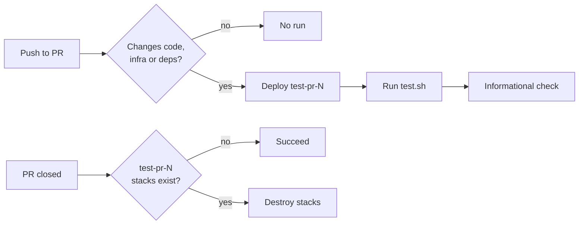

# Attempt 1: Tables and scenarios

The current spec is almost all sentences. This attempt tests how far
structure can replace prose, for readers who scan rather than read:

- **A "what changes" table** as the summary: one row per thing that will
  exist or behave differently.
- **Behaviour as When / Then scenarios**, borrowed from OpenSpec and
  Gherkin. Most of this spec's trickiness is in CI events (push, cancel,
  close), which fit a scenario table exactly.
- **A diagram** of a pull request's environment through its life.
- **Decisions as a table**: decision, chosen option, rejected options and a
  one-line reason.

Prose is kept only where a table can't hold the reasoning.

---

# Run cloud tests against deployed environments

**Date:** 2026-10-29

**Status:** accepted

## What changes

| Area             | Change                                                                                                   |
| ---------------- | -------------------------------------------------------------------------------------------------------- |
| New package      | `cloud-tests/`: an API test (Vitest) and a UI sign-in test (Playwright) against a deployed environment   |
| Local dev        | `cloud-tests/scripts/test.sh` tests your own stacks; it never deploys                                    |
| CI on PRs        | Relevant PRs deploy `test-pr-<number>`, run the tests, and report an informational check                 |
| CI on PR close   | Any closed PR's environment is destroyed                                                                 |
| AWS access       | CI uses OIDC with Platform's `GitHubDeploymentRole` — **blocked**, see [Open questions](#open-questions) |
| Docs and tooling | AGENTS.md lists `cloud-tests/`; `dev-prepare.zsh` checks for Playwright's Chromium                       |

**Why:** our tests mock AWS, so nothing checks that a deployed system works
as a whole (CHAT-1119). Getting the set-up working matters more than what
the tests cover.

**Not in scope:** more tests, blocking merges, `stag` or `prod`, asserting
on LLM answers, sweeping leftover environments, faster deploys.

## Behaviour

### Running the tests

| When                                          | Then                                             |
| --------------------------------------------- | ------------------------------------------------ |
| A developer runs `test.sh`                    | Both suites run against `$USER`'s stacks         |
| `ENVIRONMENT=test-pr-123` is set              | They run against that environment instead        |
| No stacks are tagged with the environment     | The suite fails with a message naming it         |
| AWS credentials are missing locally           | The script stops with the refresh suggestion     |
| `test-ui.sh --headed` is run                  | The argument is passed to Playwright             |
| `dev-checks.sh` or `cloud-tests-ci.yaml` runs | Format, lint and type checks run; no cloud tests |

### The tests

| When                                       | Then                                                                                 |
| ------------------------------------------ | ------------------------------------------------------------------------------------ |
| The API test invokes a new thread          | The stream has `RUN_STARTED`, a text message event and `RUN_FINISHED`, in that order |
| It then lists the thread's messages        | A user and an assistant message are stored                                           |
| The UI suite starts                        | It waits for `/api/health` to return 200, failing after a timeout                    |
| The UI test signs in through the Hosted UI | It lands on the chat page                                                            |
| The UI suite finishes, pass or fail        | Its `cloud-test-<random>` user is deleted; the password is never printed             |

### Pull requests



| When                                                 | Then                                                                                |
| ---------------------------------------------------- | ----------------------------------------------------------------------------------- |
| A push changes a [watched path](#watched-paths)      | CI deploys `test-pr-<number>` and runs `test.sh` against it                         |
| A push changes only other paths, e.g. docs           | Nothing runs                                                                        |
| A second push lands while the first run is deploying | The first run is cancelled; CloudFormation finishes or rolls back its current stack |
| The next run starts while a stack is still updating  | We expect `cdk deploy` to wait for it (checked in PR 2)                             |
| Any PR closes and has `test-pr-<number>` stacks      | Any run in progress is cancelled, then the stacks are destroyed                     |
| Any PR closes and never deployed                     | Cleanup finds no stacks and succeeds without synthesising the app                   |
| The tests fail                                       | The Playwright report and traces are uploaded                                       |

#### Watched paths

`services/`, `cdk/`, `cloud-tests/`, `pnpm-lock.yaml`, `uv.lock`, `.nvmrc`,
`.python-version`, `tsconfig.json`, `.github/actions/setup-node-pnpm-env/*`
and the workflow itself.

## Decisions

| Decision                  | Chosen                                              | Rejected                                                       | Why                                                                        |
| ------------------------- | --------------------------------------------------- | -------------------------------------------------------------- | -------------------------------------------------------------------------- |
| Where the suite lives     | Top-level `cloud-tests/`                            | `utilities/`; per service                                      | It tests the whole system; `utilities/` is dev tooling                     |
| How tests find stacks     | CloudFormation tags `Environment` and `ServiceName` | `cdk ls` / `fetch-cdk-output.sh`; importing CDK naming helpers | Synthesis is slow and needs a GitHub token; importing crosses packages     |
| Test runners              | Vitest for API, Playwright Test for UI              | Playwright for both; Playwright inside Vitest                  | Vitest matches the repo; Playwright Test has fixtures, retries and traces  |
| What the API test asserts | Event types and stored roles                        | Answer content                                                 | LLM answers vary between runs                                              |
| How the UI test signs in  | Hosted UI, as a throwaway user                      | Forged session cookie                                          | The cookie needs a test-only way into the Demo UI                          |
| Local runs                | Test existing stacks; never deploy                  | Deploy to a separate environment by default                    | Every change would be deployed twice, and could drift                      |
| When CI deploys           | Every push to a PR that matches watched paths       | After merge to a shared env; fresh env per run; on a label     | Tests before merge; reuses stacks; doesn't rely on remembering a label     |
| Agent stack               | One per PR                                          | Shared between PRs                                             | Agent changes are tested in isolation; revisit if it dominates deploy time |
| AWS access                | OIDC, Platform's `GitHubDeploymentRole`             | Our own role; Platform trusting our legacy OIDC subject        | No IAM work; matches other teams; immutable subjects are the org's format  |
| Base images               | Log in to public ECR                                | Pull-through cache                                             | Login is one step; the cache is the fallback if 429s continue              |

### Security

PR code runs with administrator access to the dev account, through
Platform's role. That's acceptable because only team members can push
branches and forks get no OIDC token. No long-lived AWS credentials are
stored in GitHub.

## Package layout

```
cloud-tests/
  src/
    environment.ts               # find stack outputs by tag
    api/thread-journey.test.ts
    ui/homepage.test.ts
    ui/global-setup.ts           # wait for health, create test user
    ui/global-teardown.ts        # delete test user
  scripts/
    dev-checks.sh                # format, lint, type-check only
    test.sh, test-api.sh, test-ui.sh
    deploy.sh, destroy.sh        # all stacks for ENVIRONMENT
```

Outputs read: `GatewayUrl`, `TokenEndpoint`, `UserPoolId`, `AppClientId`
(`ChatApiStack`); `EndpointUrl`, `SignInClientId` (`DemoUiStack`).

## Plan

| PR  | Delivers                                  | Waits on                                   | How we'll check it                                                                                     |
| --- | ----------------------------------------- | ------------------------------------------ | ------------------------------------------------------------------------------------------------------ |
| 1   | Package, CI checks, API test, run locally | Nothing                                    | Passes against your own stacks; stops without credentials                                              |
| 2   | Deploy and clean-up workflows, no tests   | Platform unblocking the role; secret added | Every [pull request](#pull-requests) scenario on a test PR; nothing left behind; deploy times recorded |
| 3   | API test in CI                            | PR 2                                       | Passes in CI; time recorded                                                                            |
| 4   | UI test, locally and in CI                | PR 3                                       | Passes; user deleted after a failing run; set **implemented**                                          |

## Risks

| Risk                                                     | Mitigation                                |
| -------------------------------------------------------- | ----------------------------------------- |
| Another AWS customer holds `test-pr-<number>-govuk-chat` | First deploy tells us; change the prefix  |
| Teardown leaves log groups or images behind              | PR 2 checks; shapes the sweeper follow-up |
| Deploys too slow for every push                          | Measure before optimising                 |
| Bedrock token spend                                      | Short prompt; path filters                |
| Cognito changes the Hosted UI                            | Selectors use roles and labels            |

## Open questions

- **What denies our repository from assuming `GitHubDeploymentRole`?** A
  test workflow on [#438](https://github.com/govuk-once/govuk-chat-v2/pull/438)
  is denied, though CloudTrail shows its token matches the trust policy.
  Likely an organisation-level control. Asked Platform.
- **Should teams deploy from CI with this role,** or a separate account such
  as `once-chat-ci`? Asked Platform.

---

## Notes for the spec skill

Result: about 1,200 words in the spec, a third of the original, and fast to
scan when rendered. But tables have costs that matter for how we review:

- **Spec pull requests are reviewed partly as diffs.** A table row is one
  long line, so a review comment can only target the whole row, and a
  one-word change shows the full row as changed. Prettier also realigns
  every row when one cell grows, which makes the diff noisy. The README asks
  reviewers to read the rendered file, but comments still land on the diff.
- **Tables can't hold reasoning.** The "Why" column forced reasons down to
  a few words. "Reuses stacks" says less than the original's sentence, and some
  reasons, such as why cancelling mid-deploy is safe, didn't fit at all and
  moved into the scenario rows.
- **Scenario tables worked well for event-driven behaviour.** The pull
  request scenarios replaced the densest part of the original design, and
  double as PR 2's test checklist. That's worth keeping.
- **The diagram adds little** that the scenario table doesn't say. Mermaid
  is worth it for flows with branches a table can't show, not by default.

For the skill:

- Suggest When / Then scenarios for behaviour that depends on events or
  inputs, written as a list (`- **When** … **then** …`) rather than a table,
  so each scenario is its own line in a diff.
- Use tables only for short, factual lookups: outputs, file lists, the
  plan's pull requests. Not for decisions or anything needing a reason.
- Let the plan double as the test plan by naming each pull request's
  checks alongside it.
- Don't add a diagram unless the flow branches in ways prose and scenarios
  don't make clear.
